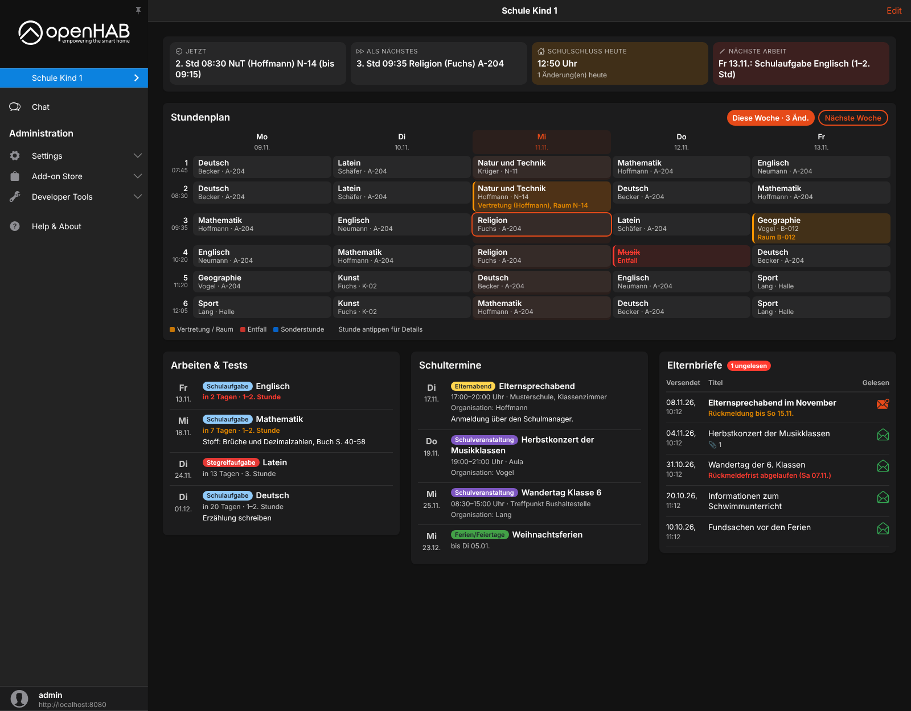

# openHAB Schulmanager Online Binding

Unofficial [openHAB](https://www.openhab.org) binding for [Schulmanager Online](https://www.schulmanager-online.de), the school platform used by many schools in Germany.
Timetable with substitutions, exams, school events, homework and parent letters (Elternbriefe) of each child, plus Main UI widgets for one page per child.



**[Documentation of the binding](bundles/org.openhab.binding.schulmanager/README.md)**

> Not affiliated with or supported by Schulmanager Online GmbH.
> Schulmanager Online has no public API; the binding uses the same interface as the Schulmanager web application, which may change at any time.

## Installation

Requires openHAB 5.0 or newer (developed and tested with 5.2.1).

1. Download `org.openhab.binding.schulmanager-<version>.jar` from the [latest release](https://github.com/simon-scherer/openhab-binding-schulmanager/releases/latest).
2. Copy it into the `addons` folder of your openHAB installation (e.g. `/usr/share/openhab/addons`).
3. Create the account bridge, either in the UI (Settings → Things → + → Schulmanager Online Binding) or with a `.things` file, see [examples/conf/things](examples/conf/things/schulmanager.things).
4. When the bridge is online, its property `students` lists the IDs of your children. Add one `student` thing per child.
5. Optional: copy the widgets and the page from [examples/conf/yaml](examples/conf/yaml) to `$OPENHAB_CONF/yaml` and the items from [examples/conf/items](examples/conf/items) to `$OPENHAB_CONF/items`.

## Repository Layout

| Path                                       | Content                                                                    |
|--------------------------------------------|----------------------------------------------------------------------------|
| `bundles/org.openhab.binding.schulmanager` | The binding, structured like a bundle in openhab-addons                    |
| `examples/conf`                            | Things, items, rules, Main UI widgets and page (texts in German)           |
| `tools/standalone-build`                   | Build without Maven against API stubs (for quick local builds)             |
| `.github/workflows/build.yml`              | Maven build inside an openhab-addons checkout, releases on tags `v*`       |

## Building

The regular build runs on GitHub Actions: it copies the bundle into a checkout of [openhab-addons](https://github.com/openhab/openhab-addons) and builds it with Maven, including the null analysis, static code analysis and formatting checks of openHAB.

Locally the same works with:

```shell
git clone --depth 1 --branch 5.2.1 https://github.com/openhab/openhab-addons
cp -r bundles/org.openhab.binding.schulmanager openhab-addons/bundles/
# add <module>org.openhab.binding.schulmanager</module> to openhab-addons/bundles/pom.xml
cd openhab-addons && mvn spotless:apply install -pl :org.openhab.binding.schulmanager
```

Without Maven, `tools/standalone-build/build.sh` compiles the bundle with plain `javac` against API stubs (JDK 21, gson and slf4j-api jars in `tools/standalone-build/lib`).

## Privacy

The binding only reads data. It never confirms, answers or deletes anything in Schulmanager.
Credentials stay in your openHAB configuration; a remembered two-factor device is stored in `$OPENHAB_USERDATA/schulmanager`.
Please remove personal data (names, IDs, letter texts) from logs before posting them in issues.

## License

[Eclipse Public License 2.0](LICENSE), like openHAB.
The login flow and the API calls are based on the Home Assistant integration [Schulmanager-homeassistant](https://github.com/MrIcemanLE/Schulmanager-homeassistant) by MrIcemanLE (MIT License), see [NOTICE](bundles/org.openhab.binding.schulmanager/NOTICE).
