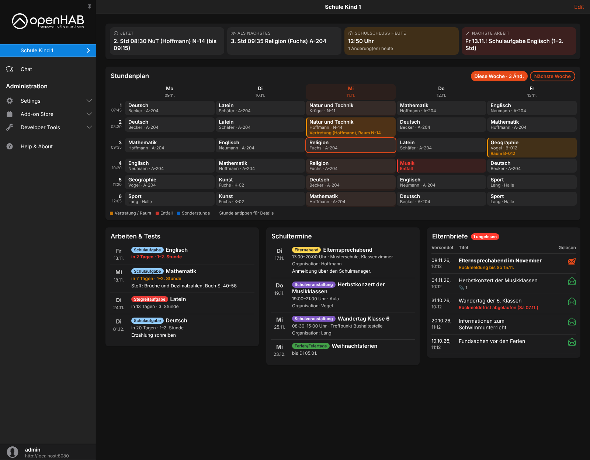
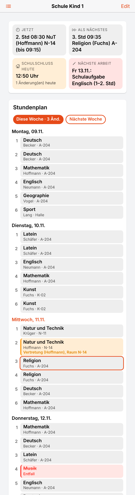
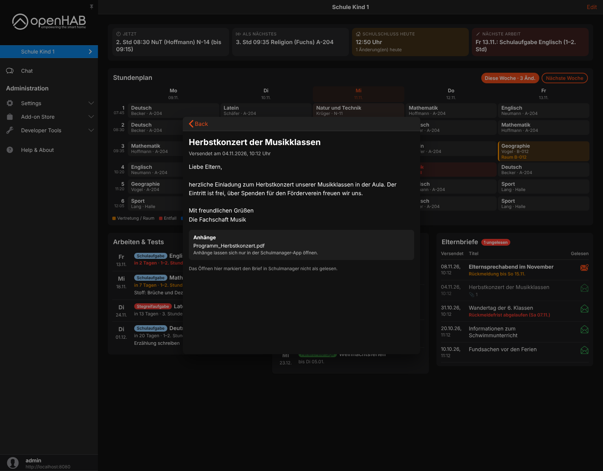

# Schulmanager Online Binding

This binding connects openHAB to [Schulmanager Online](https://www.schulmanager-online.de), a school platform used by many schools in Germany.
It provides the timetable of each child including substitutions and cancellations, upcoming exams and tests, school events, homework and parent letters (Elternbriefe).

Together with the Main UI widgets from the [examples](https://github.com/simon-scherer/openhab-binding-schulmanager/tree/main/examples) you get one page per child:



> **Note:** Schulmanager Online does not offer a public API.
> The binding uses the same interface as the Schulmanager web application, which may change at any time.
> It is not affiliated with or supported by Schulmanager Online GmbH.

All content comes from Schulmanager in German, so the text channels (e.g. the timetable of today) are German as well.

## Supported Things

| Thing type | Description                                                                                          |
|------------|------------------------------------------------------------------------------------------------------|
| `account`  | Bridge for one Schulmanager login (parent or student account, also accounts with several schools).  |
| `student`  | One child of the account: timetable, exams, school events and homework.                              |

## Discovery

There is no automatic discovery.
After the `account` bridge is online, its property `students` lists the ID and name of every child, e.g. `1234567 = Max Muster (Musterschule)`.
Use this ID as `studentId` of the `student` thing.

## Thing Configuration

### `account` Bridge Configuration

| Name                | Type    | Description                                                                                                                                                     | Default    | Required | Advanced |
|---------------------|---------|-----------------------------------------------------------------------------------------------------------------------------------------------------------------|------------|----------|----------|
| `username`          | text    | E-mail address or user name as used in the Schulmanager app                                                                                                     | N/A        | yes      | no       |
| `password`          | text    | Password                                                                                                                                                        | N/A        | yes      | no       |
| `twoFactorCode`     | text    | Only for accounts with two-factor login and only once (see below)                                                                                               | N/A        | no       | no       |
| `refreshInterval`   | integer | Minutes between two updates (15–1440)                                                                                                                           | 60         | no       | no       |
| `scheduleWeeks`     | integer | Weeks of timetable: current week plus following weeks (1–3); on weekends one more week is loaded                                                               | 2          | no       | no       |
| `teacherDisplay`    | text    | How teachers are shown: `lastname`, `name` (first and last name) or `abbreviation`                                                                              | `lastname` | no       | no       |
| `subjectDisplay`    | text    | How subjects are shown: `name` (e.g. Geographie) or `abbreviation` (e.g. Geo)                                                                                   | `name`     | no       | no       |
| `subjectNames`      | text    | Custom name per subject, e.g. `Ev=Religion, Swd=Sport`. The key is the abbreviation or the official name. Overrides `subjectDisplay`.                        | N/A        | no       | no       |
| `lettersLoadUnread` | boolean | Also load the text of parent letters that are still unread (see below)                                                                                          | `false`    | no       | yes      |
| `examDaysAhead`     | integer | Days ahead for exams, tests and school events (7–365)                                                                                                           | 180        | no       | yes      |

#### Two-Factor Login

If two-factor login is enabled for the account, the bridge goes offline with a message asking for the code.
Enter the current code of the authenticator app (or the code from the e-mail) as `twoFactorCode` and save.
Like the Schulmanager app, the binding then registers a remembered device and stores it in `$OPENHAB_USERDATA/schulmanager`, so the code is not needed again.
The old code can stay in the configuration; it is ignored as long as the device is remembered.
When the bridge is removed, the remembered device is removed from the account as well.

#### Parent Letters and Read State

The binding never confirms or answers a letter.
By default it only loads the text of letters that are already marked as read in Schulmanager.
It is not yet verified whether loading the text of an unread letter marks it as read for the school, therefore `lettersLoadUnread` is off by default.

### `student` Thing Configuration

| Name        | Type | Description                                                    | Default | Required | Advanced |
|-------------|------|----------------------------------------------------------------|---------|----------|----------|
| `studentId` | text | Schulmanager ID of the child (property `students` of the bridge) | N/A     | yes      | no       |

## Channels

### `account` Bridge Channels

| Channel          | Type     | Read/Write | Description                                                                  |
|------------------|----------|------------|------------------------------------------------------------------------------|
| `lettersUnread`  | Number   | R          | Number of unread parent letters                                              |
| `lettersList`    | String   | R          | Titles of the unread parent letters, one per line                            |
| `lettersWidget`  | String   | R          | Latest parent letters with text (JSON) for the widget `sm_elternbriefe`      |
| `messagesUnread` | Number   | R          | Number of unread messenger messages                                          |
| `lastUpdate`     | DateTime | R          | Time of the last successful update                                           |

### `student` Thing Channels

Group `schedule` (timetable):

| Channel              | Type     | Read/Write | Description                                                                      |
|----------------------|----------|------------|----------------------------------------------------------------------------------|
| `today`              | String   | R          | Timetable of today, one lesson per line                                          |
| `tomorrow`           | String   | R          | Timetable of tomorrow                                                            |
| `nextDay`            | String   | R          | Timetable of the next day with lessons (e.g. Monday when it is Friday)           |
| `nextDayDate`        | DateTime | R          | Date of the next school day                                                      |
| `currentLesson`      | String   | R          | Current lesson, "Pause" or "Kein Unterricht"                                     |
| `nextLesson`         | String   | R          | Next lesson today                                                                |
| `firstLessonToday`   | DateTime | R          | Start of the first lesson today                                                  |
| `lastLessonToday`    | DateTime | R          | End of the last lesson today                                                     |
| `firstLessonNextDay` | DateTime | R          | Start of the first lesson of the next school day                                 |
| `changesToday`       | Number   | R          | Number of substitutions, cancellations and room changes today                    |
| `changesTomorrow`    | Number   | R          | Number of changes tomorrow                                                       |
| `changesSummary`     | String   | R          | Changes of today and tomorrow as text                                            |
| `json`               | String   | R          | Complete timetable as JSON (advanced)                                            |
| `widget`             | String   | R          | Timetable for the widget `sm_stundenplan`                                        |
| `changed`            | Trigger  |            | Fires `CHANGED` when the changes from today on change                            |

Group `exams` (exams and school events):

| Channel               | Type     | Read/Write | Description                                                     |
|-----------------------|----------|------------|-----------------------------------------------------------------|
| `next`                | String   | R          | Next exam or test                                               |
| `nextDate`            | DateTime | R          | Date of the next exam                                           |
| `daysUntilNext`       | Number   | R          | Days until the next exam                                        |
| `countNext14Days`     | Number   | R          | Number of exams in the next 14 days                             |
| `list`                | String   | R          | Upcoming exams, one per line                                    |
| `nextSchoolEvent`     | String   | R          | Next school event from the school calendar                      |
| `nextSchoolEventDate` | DateTime | R          | Date of the next school event                                   |
| `json`                | String   | R          | Exams and events as JSON (advanced)                             |
| `widget`              | String   | R          | Exams and events for the widget `sm_arbeiten`                   |
| `new`                 | Trigger  |            | Fires with the text of a newly added exam (not on the first update) |

Group `homework` (only if the school shares homework with families):

| Channel       | Type     | Read/Write | Description                                                         |
|---------------|----------|------------|---------------------------------------------------------------------|
| `latest`      | String   | R          | Latest homework                                                     |
| `latestDate`  | DateTime | R          | Date of the latest homework                                         |
| `countRecent` | Number   | R          | Homework entries of the last 7 days                                 |
| `list`        | String   | R          | Homework of the last 14 days                                        |
| `json`        | String   | R          | Homework as JSON (advanced)                                         |
| `widget`      | String   | R          | Homework for the widget `sm_hausaufgaben`                           |
| `new`         | Trigger  |            | Fires with the text of new homework (not on the first update)       |

Group `info`:

| Channel      | Type     | Read/Write | Description                        |
|--------------|----------|------------|------------------------------------|
| `school`     | String   | R          | Name of the school                 |
| `lastUpdate` | DateTime | R          | Time of the last successful update |

The `widget` channels contain prepared JSON for the Main UI widgets.
They change often and are large, so they should not be persisted.

## Full Example

### Thing Configuration

```java
Bridge schulmanager:account:konto "Schulmanager Konto" [ username="eltern@example.de", password="secret", teacherDisplay="lastname", subjectDisplay="name", subjectNames="Ev=Religion, Swd=Sport" ] {
    Thing student kind1 "Schulmanager Kind 1" [ studentId="1234567" ]
}
```

### Item Configuration

```java
String   SM_Kind1_AktuelleStunde     "Jetzt [%s]"                 {channel="schulmanager:student:konto:kind1:schedule#currentLesson"}
String   SM_Kind1_NaechsteStunde     "Als Nächstes [%s]"          {channel="schulmanager:student:konto:kind1:schedule#nextLesson"}
DateTime SM_Kind1_EndeHeute          "Schulschluss [%1$tH:%1$tM]" {channel="schulmanager:student:konto:kind1:schedule#lastLessonToday"}
String   SM_Kind1_NaechsteArbeit     "Nächste Arbeit [%s]"        {channel="schulmanager:student:konto:kind1:exams#next"}
String   SM_Kind1_StundenplanWidget                               {channel="schulmanager:student:konto:kind1:schedule#widget"}
String   SM_Kind1_ArbeitenWidget                                  {channel="schulmanager:student:konto:kind1:exams#widget"}
Number   SM_Elternbriefe             "Ungelesene Elternbriefe [%d]" {channel="schulmanager:account:konto:lettersUnread"}
String   SM_ElternbriefeWidget                                    {channel="schulmanager:account:konto:lettersWidget"}
```

### Rule Example

```java
rule "Schulmanager: Stundenplan geändert"
when
    Channel "schulmanager:student:konto:kind1:schedule#changed" triggered CHANGED
then
    sendBroadcastNotification("Stundenplan geändert:\n" + SM_Kind1_Aenderungen.state.toString)
end
```

## Main UI Widgets

The repository contains ready-to-use widgets and a page as YAML files for `$OPENHAB_CONF/yaml` (openHAB 5):

| Widget            | Content                                                                                 |
|-------------------|-----------------------------------------------------------------------------------------|
| `sm_status`       | Current lesson, next lesson, end of school today, next exam                             |
| `sm_stundenplan`  | Week timetable with substitutions; tap a lesson for details; list view on small screens |
| `sm_arbeiten`     | Exams and tests and/or school events (property `show`)                                  |
| `sm_hausaufgaben` | Homework                                                                                |
| `sm_elternbriefe` | Parent letters like in the app; tap a letter to read it in a popup                      |

The layout adapts to the screen: three columns on wide screens, list views on phones.

| Phone                                  | Parent letter                              |
|----------------------------------------|--------------------------------------------|
|            |      |

## Credits

The login flow and the API calls are based on the Home Assistant integration [Schulmanager-homeassistant](https://github.com/MrIcemanLE/Schulmanager-homeassistant) by MrIcemanLE (MIT License).
